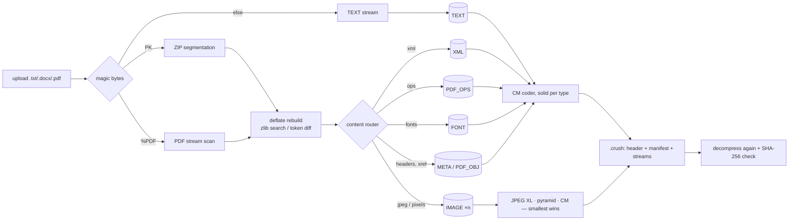

# CRUSH — architecture and the mathematics behind it

## 1. Pipeline



```
crush/
  detect.py            magic-byte detection
  containers/zipc.py   ZIP/DOCX segmentation            containers/pdf.py   PDF raw scanning
  containers/deflate.py  bit-exact deflate rebuild      containers/common.py routing helpers
  cm/reference.py      pure-Python coder + order-2      cm/engine.py        Numba CM engine
  cm/tables.py         integer stretch/squash tables
  images/png.py        PNG split/filters                images/jxl.py       cjxl/djxl wrapper
  images/pyramid.py    residual pyramid codec
  archive/format.py    binary layout                    archive/manifest.py recipes + Builder (dedup)
  codecs.py            stream types, codec ids, codec selection
  pipeline.py          compress/decompress/verify, multiprocessing
  lossy/optimise.py    optional optimised mode
  service.py · cli.py · api/app.py · bench/
```

## 2. Why documents need *un*-compression first

DOCX is a ZIP of deflated XML, and most PDF streams are zlib-deflated. Deflate output is close to
8 bits/byte, so any second compressor sees noise (the baselines gain only ~20% on DOCX, mostly from
headers). The only way to do much better is to model the **inflated** data — but then decompression
must regenerate the *exact original deflate bits*, which depend on the encoder's choices.

### 2.1 Fast path: zlib parameter search
If zlib with some `(level 1–9, memLevel 1–9, strategy)` reproduces the bytes exactly, we store just
those 3 numbers. Files written by zlib-based tools (python-docx, LibreOffice, pdfTeX, ReportLab)
match. The search compresses incrementally and aborts at the first differing byte, so a wrong guess
costs only a few KB of work.

### 2.2 General path: token reconstruction
Microsoft Word has its own deflater: across the 10 Word-made DOCX files in the corpus only **20% of
members (5% of bytes)** match any zlib setting. CRUSH therefore implements a preflate-style rebuild:

1. Parse the original deflate stream completely: blocks (stored / fixed / dynamic), the exact bits of
   every dynamic Huffman header, and the LZ77 token sequence (literal or `(length, distance)`).
2. Run a deterministic **predictor** on the inflated data. At token position *i* it walks a hash chain
   of earlier positions *j* with `data[j:j+3] = data[i:i+3]`, nearest first (window 32 KiB, ≤ 2048
   steps), computing each candidate's match length ℓⱼ, and `L* = max ℓⱼ`.
3. Code each actual token relative to the prediction:

| actual token | symbol |
|---|---|
| literal | `0` |
| match with `len = L*` at the first candidate reaching `L*` | `1` |
| other match | `2, (L* − len), rank` where rank = index of the distance among candidates with ℓⱼ ≥ len |
| match not in the candidate list | `3, len−3, distance` |
| end of block | `4` |

4. Copy block headers verbatim; Huffman codes themselves are *canonical*, i.e. a pure function of
   the code lengths in the header, so the decoder re-derives them: for code lengths lₛ,
   `code(s) = next_code[lₛ]++` with `next_code[l] = (next_code[l−1] + count[l−1]) << 1`.

Since the decoder already holds the inflated data, it reruns the same predictor and recovers every
token. Every reconstruction is executed and compared at compression time; anything not exactly
reproducible (e.g. a non-canonical length-258 code) falls back to storing the original bytes.
Result on the Word corpus: **192 / 192 members rebuilt bit-exactly**; side information is ≈ 9% of
inflated size before CM and ≈ 1.8% after.

## 3. Arithmetic coding

Each byte is coded as 8 binary events, MSB first. For a bit *y* with model probability
*p = P(y = 1)*, the ideal code length is −log₂ P(y). The coder keeps an interval `[x1, x2]` of
32-bit integers and splits it at

```
xmid = x1 + ⌊(x2 − x1) · p / 2¹⁶⌋        (p a 16-bit integer, 0 < p < 2¹⁶)
y = 1 → [x1, xmid]          y = 0 → [xmid + 1, x2]
```

computed exactly as `x1 + (r >> 16)·p + ((r & 0xFFFF)·p >> 16)` with `r = x2 − x1`, so nothing
overflows 64 bits. After *n* bits the interval width is ≈ 2³² ∏ P(yᵢ), hence the output length is

```
L ≈ Σᵢ −log₂ P(yᵢ) + O(1) bits,
```

i.e. within a constant of the information content under the model: **all compression comes from
prediction quality**. When the top bytes of x1 and x2 agree they are final and are shifted out
(renormalisation). `tests/test_reference.py` checks that the coder stays within 1% + 8 bytes of
the information content on a 50 000-bit sequence.

## 4. Context models

Every model maps a context to a slot holding a 16-bit probability *p* and a hit count *n*, updated
after each bit by

```
p ← p + (y·2¹⁶ − p) · 1/(n + 1.5),    n ← min(n + 1, 60)
```

For the first observations this is the running mean of the bits seen (an adaptive Krichevsky–Trofimov
style estimate); once *n* saturates it becomes an exponential moving average with rate 1/61.5, so
models keep adapting to non-stationary data.

| input | context |
|---|---|
| order-0 | partial byte `c0` (1 followed by the bits seen so far) |
| order-1…6 | hash of the previous *k* bytes ⊕ `c0` |
| word | hash of the current word (letters, case-folded, UTF-8 bytes ≥ 128 count as letters) |
| word bigram | hash(current word, previous word) |
| column 1 | (column since last `\n`, byte directly above in the previous line) |
| column 2 | (byte above, previous byte) |
| record | (byte one record back, previous byte); record length = image stride, or auto-detected when the same byte value repeats at the same distance ≥ 4 times |
| match | if the last 6 bytes occurred before, predict the bit that followed; confidence learned per match length |

**Cache-aware tables.** Hashed slots are grouped in 16-slot buckets addressed once per nibble, so the
4 bits of a nibble touch one cache line per model; each slot packs `p << 8 | n` in 32 bits. This made
the engine ~2.5× faster than one random access per bit.

## 5. Mixing and SSE

### 5.1 Logistic mixing
Let `st(p) = ln(p / (1−p))` (stretch) and `σ(x) = 1/(1+e^{−x})` (squash). With inputs
`sᵢ = st(pᵢ)` and weights `wᵢ`:

```
p = σ( Σᵢ wᵢ · sᵢ )
```

**Derivation of the update.** The coding cost of bit *y* is `C = −y ln p − (1−y) ln(1−p)`. Because
`dσ/dx = σ(1−σ)`,

```
∂C/∂wᵢ = −( y/p − (1−y)/(1−p) ) · p(1−p) · sᵢ = −(y − p) · sᵢ
```

so gradient descent with learning rate η gives exactly the rule used:

```
wᵢ ← wᵢ + η · (y − p) · sᵢ
```

i.e. online logistic regression minimising code length directly. The cost is convex in *w*, so the
mixer converges to the best fixed linear combination in the stretched domain, and it re-adapts
when the data change.

**Fixed point.** `sᵢ` is in units of 1/256 nat clipped to ±2047, weights in 16.16 fixed point,
`p` is 16-bit; `σ` is linear interpolation between 33 integer knots (one per half-nat) and `st` is
its exact integer inverse, built once with no floating point — which is why archives are bit-identical
across Windows/Linux/macOS. Three weight sets are selected by small contexts — (match length
bucket, c0), previous byte, (number of orders 1–6 whose context was seen before, c0) — and their
outputs are averaged in the stretched domain (η ≈ 12/1024 in these units).

### 5.2 APM / SSE
An adaptive probability map refines *p* under a context *c*: the stretched *p* is quantised into 33
buckets, the output is the linear interpolation of the two neighbouring bucket values for *c*, and
the nearer bucket moves 1/64 of the way to the coded bit. Two APMs are used — order-1
(c0 + previous byte) and a hashed order-2 context — and averaged with the mixer output
(`p_final = (p + APM₁ + 2·APM₂)/4`, clipped to [32, 65504]).

### 5.3 Measured contribution (ablation, 2.37 MB of English text)

| configuration | bits/char |
|---|---:|
| orders 0–6, fixed weights | 2.289 |
| + learned mixer | 1.975 |
| + APM/SSE | 1.950 |
| + word + column/record models | 1.845 |
| + match model | 1.832 |
| + solid mode | 1.780 |

(bzip2 −9: 2.208, xz/lzma −9e: 2.439 on the same files.)

## 6. Images

* **JPEG** — `cjxl --lossless_jpeg=1` re-entropy-codes the DCT coefficients (~20% smaller) and
  `djxl` reconstructs the original file bit-for-bit; every transcode is decoded and compared before
  use. JPEGs are never decoded to pixels in lossless mode.
* **PNG** — split into chunks; IDAT payloads form a zlib stream of *filtered* rows. CRUSH inflates
  it, records the filter type of each row, unfilters to pixels (Sub/Up/Avg/Paeth, with
  Paeth(a,b,c) = the one of a,b,c closest to a+b−c), and codes pixels as an image stream. Rebuild:
  re-filter with the recorded types → re-deflate (zlib params or token rebuild) → re-chunk with fresh
  CRC-32. Any inconsistency falls back to storing the PNG.
* **Raw PDF images** (`/FlateDecode`, 8-bit Gray/RGB/CMYK, no predictor) take the same pixel route.
* **Pixel codec selection** — each image is coded with plain CM (record length = row stride, so the
  record model sees the pixel above), JPEG XL lossless, and the residual pyramid; the smallest wins.

### 6.1 Residual pyramid (experimental)
```
d = down(x):   d[i,j] = ⌊(x[2i,2j] + x[2i+1,2j] + x[2i,2j+1] + x[2i+1,2j+1]) / 4⌋
u = up(d):     u[2i+a, 2j+b] = ⌊(2·d[i,j] + d[i±1,j] + d[i,j±1] + 2) / 4⌋   (neighbour side by a, b)
r = (x − u) mod 256 → zig-zag (0,−1,1,−2,… → 0,1,2,3,…) → CM
x = (up(d) + r) mod 256,   recursively until the plane is ≤ 16 px
```
Everything is integer, so the decoder's `up(d)` is identical and reconstruction is exact. On the
corpus' flat-colour charts it loses clearly to JPEG XL and CM (4.2 KB vs 0.1 KB / 0.3 KB for a
300×200 chart): averaging blurs hard edges into large residuals. It is kept as a benchmarked
experiment, not a production path.

## 7. Parallelism, dedup, verification

* Independent streams are coded in a `multiprocessing` pool (spawn context — identical on Windows,
  Linux and macOS) when the total exceeds 2 MiB; results are byte-identical to serial coding
  (`test_parallel_matches_serial`). Numba functions use `cache=True` so workers load compiled code.
* SHA-256 dedup: identical members/streams (≥ 64 bytes) inside one archive are stored once.
* After packing, the archive is decompressed in-process and every file's SHA-256 compared. A file
  that fails (none in the corpus) is automatically re-packed verbatim, so a container-parsing bug
  can cost ratio but never correctness.

## 8. Optimised (lossy) mode

Effective resolution `dpi = pixel_width / display_width_in`. DOCX display width comes from
`<wp:extent cx>` (914 400 EMU per inch); PDF from the CTM at the `Do` operator, tracking `q`/`Q`/`cm`
(`width_pt = ‖(a, b)‖`, 72 pt per inch). Photos above 200 dpi are Lanczos-resampled to 200 dpi and
re-encoded as JPEG (q = 82); images with < 1024 colours in a thumbnail (charts, screenshots, text) are
kept lossless unless above 300 dpi. Never upsampled; display geometry untouched; replaced only if
smaller. The report lists every image with before/after pixels, dpi, bytes and PSNR. The optimised
document is then compressed losslessly, so the SHA-256 badge verifies the optimised copy.

## 9. Complexity and resources

* Time: O(n) per byte × (#models) — ≈ 0.6 MB/s for text on one core, slower for documents because of
  deflate analysis and verification (the benchmark's "enc MB/s" excludes verification).
* Memory: hash tables 11 × 2^tb × 4 bytes with tb = min(22, ⌈log₂ n⌉ + 4) (≤ 176 MiB) plus APMs;
  peak ≈ 400 MiB per process on the corpus. Worker count defaults to min(4, cores − 1).
